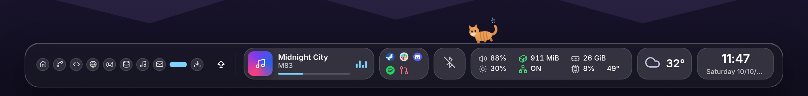
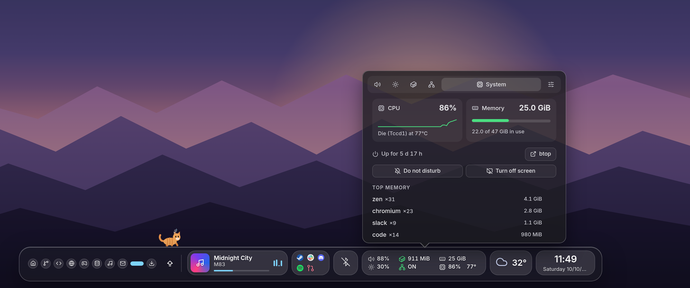
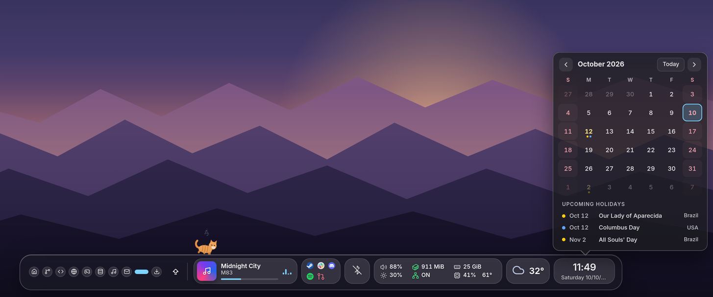
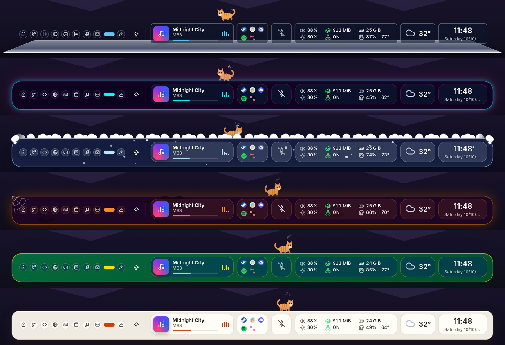
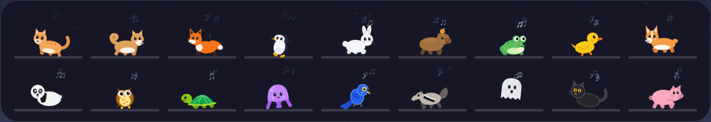
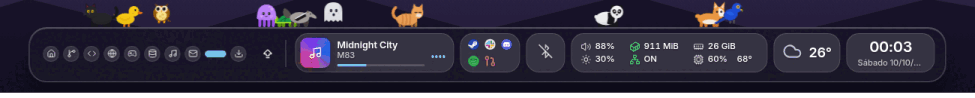
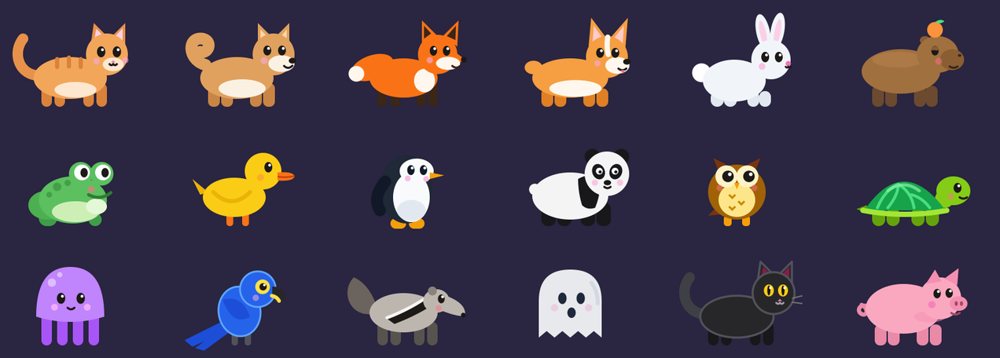

# smart-shell

A dock for Wayland desktops: workspaces, apps
and live status widgets in one glass bar, with themes, particle effects and
little pets that react to CPU load.

The shell is a [Quickshell](https://quickshell.outfoxxed.me/) (QML) config that
runs as a layer-shell surface on Hyprland (`shell/`). Its approved visual spec
is an HTML prototype with the same component structure (`prototype/`); the
shell ports it piece by piece.



| Control center | Calendar |
|---|---|
|  |  |

**Themes** - aqua, neon, snowy, halloween, canarinho and paper (glass is the default):



**Pets** - dancing to the music and walking with the CPU load:







The screenshots are of the prototype with its sample data.

## Repository layout

```
prototype/   HTML/JS design lab (vanilla Web Components, no build step)
shell/       the real Quickshell config (QML)
docs/        architecture and design notes
systemd/     user units for background jobs (installed by tools/install-services.sh)
tools/       helper scripts (icons, calendar export, service install)
```

## Install

Only the core is required; each widget needs its own packages and stays
visible but disabled (saying what's missing) until they're there. Install the
core, then the lines for the widgets you want.

**Arch / CachyOS**

```sh
paru -S quickshell inter-font papirus-icon-theme qt6-5compat networkmanager iputils curl jq libnotify  # core
paru -S ddcutil                  # brightness (also: sudo modprobe i2c-dev, user in the i2c group)
paru -S hyprsunset               # night light
paru -S docker lazydocker        # Docker tab (also: systemctl enable --now docker, user in the docker group)
paru -S bluez bluez-utils blueman python-bluetooth-battery  # Bluetooth tile, headset battery
paru -S btop                     # System tab's btop button (opens in kitty; `commands.monitor` picks the terminal)
paru -S openvpn3                 # VPN switch
paru -S github-cli               # pull requests (then: gh auth login)
paru -S nodejs                   # YouTube Music's like state
paru -S gpu-screen-recorder      # recording indicator
paru -S cava                     # pets dance to the music, the player's eq follows it
```

**Fedora**

```sh
sudo dnf copr enable errornointernet/quickshell
sudo dnf install quickshell rsms-inter-fonts papirus-icon-theme qt6-qt5compat NetworkManager iputils curl jq libnotify  # core
sudo dnf install ddcutil         # brightness
sudo dnf install moby-engine     # Docker tab (lazydocker: see its README)
sudo dnf install bluez blueman   # Bluetooth tile
sudo dnf install btop            # System tab's btop button
sudo dnf install gh              # pull requests (then: gh auth login)
sudo dnf install nodejs          # YouTube Music's like state
sudo dnf install cava            # pets dance to the music, the player's eq follows it
```

**Debian / Ubuntu**

Quickshell isn't packaged: build it from
[source](https://quickshell.outfoxxed.me/docs/guide/install-setup/).

```sh
sudo apt install fonts-inter papirus-icon-theme qml6-module-qt5compat-graphicaleffects network-manager iputils-ping curl jq libnotify-bin  # core
sudo apt install ddcutil         # brightness
sudo apt install docker.io       # Docker tab (lazydocker: see its README)
sudo apt install bluez blueman   # Bluetooth tile
sudo apt install btop            # System tab's btop button
sudo apt install gh              # pull requests (then: gh auth login)
sudo apt install nodejs          # YouTube Music's like state
sudo apt install cava            # pets dance to the music, the player's eq follows it
```

Outside Arch, `hyprsunset`, `openvpn3` and `gpu-screen-recorder` come from
their projects (or Flatpak / COPR), and the headset battery from
`pip install bluetooth_battery`. `qt6-shadertools` is only needed to rebuild
`shell/shaders/*.qsb` after editing a shader. Calendar events need Python,
Thunderbird and the export timer (see [Calendar events](#calendar-events)).

On Arch, `bin/smart-shell` does all of the above, the groups and services
included:

```sh
ln -s ~/projects/smart-shell/bin/smart-shell ~/.local/bin/   # once
smart-shell install full          # core + every widget
smart-shell install pets prs      # just some widgets: brightness nightlight docker
                                  #   bluetooth events system pets vpn prs music recording
smart-shell hyprland              # add the exec-once and blur lines (asks first)
smart-shell doctor                # what each widget is still missing
smart-shell restart               # also: start, stop, log
```

To add a widget later: install its packages, then add its id to a group in
`dock` (or `quick`) in the config - see [Making it yours](#making-it-yours).

Run it:

```sh
qs -p ~/projects/smart-shell/shell          # hot-reloads on save
qs log -p ~/projects/smart-shell/shell      # its log
qs ipc -p ~/projects/smart-shell/shell call popover open control-center docker
```

Hyprland (`hyprland.conf`):

```ini
exec-once = qs -p ~/projects/smart-shell/shell

# blur behind the dock's glass and its popovers; ignore_alpha keeps the
# transparent parts of the surface sharp
layerrule {
    name = smart-shell-blur
    match:namespace = smart-shell
    blur = yes
    blur_popups = yes
    ignore_alpha = 0.2
}

general {
    # the dock reserves its own space (exclusive zone); keep the bottom gap
    # small so windows sit evenly between the dock and the screen edge
    gaps_out = 20, 20, 10, 20
}
```

Configuration lives in `~/.config/smart-shell/config.json` (start from
[`config/config.example.json`](config/config.example.json); it reloads live).
The theme picked in the dock settings tab is written back to it (`theme`; the
file is re-saved as formatted JSON). So are the workspaces style
(`workspaces.style`) and the clock format (`clock.format`). The tab's other settings (size, magnification, which
widgets show, pet, language) are saved in Quickshell's state file instead.

Calendar events need the export timer: `tools/install-services.sh` (see
[Calendar events](#calendar-events)).

## Widgets and what they need

- **Themes** - `theme`: `glass` (default), `midnight`, `aqua`, `neon`,
  `paper`, `canarinho`, `snowy`, `halloween`. Each recolours the dock, tiles
  and popovers; aqua stands the dock on a glass shelf, halloween hangs a cobweb
  in its corner, snowy puts a snow cap on it. Snowy (snow) and halloween
  (bats) also animate particles, and midnight / neon / snowy / halloween tint
  the glass - all of it inside the dock only, at 30 fps, paused while a
  fullscreen window is focused. Hyprland's blur applies to every theme.
- **Pet** - one per dock, picked in the dock settings ("Nenhum" for none):
  cat, shiba, fox, penguin, bunny, capybara, frog, duck, corgi, panda, owl,
  turtle, octopus, macaw, anteater, ghost, black cat and pig. It
  walks on the dock's top edge. Hover for its mood, click for a heart; it
  holds still while a fullscreen window is focused. What it does, in order of
  priority:

  | When | The pet | Config |
  |---|---|---|
  | a work meeting is on (an event in the `work` category, see Clock) | types on a laptop | `events.categories` |
  | YouTube Music plays | looks around for a moment, then eases into its own dance with music notes, every 1.5-4 s turning around or taking a few steps; when the song stops it keeps going a second, then winds down. With `cava` the loudness sets the tempo, the size of the moves and the strolls (a run when it's loud) | `pets.danceWith` (default `["music.youtube.com"]`, matched against a player's url, identity, desktop entry or command line) |
  | CPU below 10% / 40% / 72% / above | sleeps / idles and strolls / walks / runs | `thresholds.cpu.sleep` / `.idle` / `.walk` |
  | free RAM below 8 GiB / 4 GiB | heavy: 0.6x speed, lower hops, squashed; at 4 GiB a sweat drop | `thresholds.memFreeGiB.warn` / `.crit` |
  | die temperature (Tccd1) from 85 °C / 99 °C, while it walks or runs | reddish; at 99 °C heat waves above it | `thresholds.tempC.warn` / `.crit` |

  The same `thresholds` colour the quick tile (memory, CPU temperature). With
  `thresholds.tempC.roomTemp` set (e.g. 30), warn / crit become degrees over
  that room temperature.
- **Workspaces** - Hyprland. `workspaces.style` (also in the dock settings)
  picks how occupied workspaces show: `icons` (default; per workspace id in
  `workspaces.icons`, Lucide names), `numbers` (their id; the active pill shows
  its number too) or `dots`.
- **Caps Lock** - reads `/sys/class/leds/*::capslock` (no setup).
- **Apps** - the pinned apps in `apps.pinned`: desktop entry ids, or
  `{ "id", "name", "icon" }` to override the entry; only pinned apps show,
  like the prototype's row. Running apps get a dot;
  click focuses or launches, right click closes the app's windows. Web apps
  run by Chromium are matched by their `--app=` host.
- **Music** - any MPRIS player. The playing one wins, then the one that
  played last; `music.ignore` (default `["whatsapp"]`) lists substrings of a
  player's identity, desktop entry, title, url or command line to never show.
  A browser tab with no media metadata (Reddit) shows the site and where on
  it (r/subreddit) instead of the page title.
  Hover shows the full title and artist; the progress bar follows
  the position once a second. With `cava` installed the four eq bars follow
  the audio (bass to treble); without it they bounce. Right-click focuses the player's window, or,
  for YouTube Music, opens its volume, controls and like. The heart turns red
  when the song is liked: start the app with `--remote-debugging-port=9223`
  (listens on localhost only; `YTM_DEBUG_PORT` changes it) and
  `tools/ytm-like.mjs` (Node 22+) reads and clicks the app's like button.
  Without the port the like is sent as the app's `+` shortcut and its state
  is unknown.
- **Pull requests** - your open PRs in any repo, read with the `gh` CLI's
  own login (`gh auth login`) every hour or from the refresh button.
  It rides in the tray as one more item: the PR icon in the worst state's
  colour, the open count on hover; the popover groups
  them by repo (open when one needs action) and a click opens the PR in the
  default browser. States: pipeline failed or conflict (red), behind the base
  branch (yellow), checks running, pipeline green (one tick), green and
  approved (two ticks), merged
  (a notification, then listed until dismissed with its ×). The eye on a repo hides
  it from the list and the count (saved); "Show hidden" lists them again.
- **Notifications** - the shell is the notification server (replaces mako;
  drop its `exec-once`). Popups stack above the dock's right end in the dock's
  glass: the sender's picture (WhatsApp, Slack) with the app's icon as a badge,
  or the app's icon, or a bell; the title, the message in up to 2 lines and the
  actions. They last 5 s (3 s low, critical until closed); hover holds them and
  shows ×; a click runs the default action and brings the app's window
  forward (its workspace, then the window). `notifications.rules` restyle some,
  matched as substrings on `appName` / `summary` / `body`: `title`, `app`,
  `icon` (an icon name or path, e.g. `claude-desktop` for Claude Code's kitty
  notifications), `focusTitle` (a regex on the window title choosing which
  of the app's windows a click brings forward, e.g. the kitty running Claude
  Code, whose title starts with its status glyph),
  `style: "love"` (wine glass, beating heart) and `timeout` (ms, 0 = until
  closed).
  Do not disturb (a toggle in the System tab, next to "Turn off screen", or `qs ipc -p <shell> call notifications
  toggleDnd` for a keybind) holds every popup except rules with `dnd: true`;
  a muted bell shows after the caps lock, and a click on it turns it off.
- **Screen recording** - while `gpu-screen-recorder` runs, a red dot and the
  elapsed time show after the caps lock; a click stops it by running
  `commands.record`. The recording script tells the dock with
  `qs ipc -p <shell> call recording started|stopped` (a check every 3 s
  catches the rest).
- **Tray** - StatusNotifierItem apps. `tray.hidden` leaves items out (Bluetooth
  has its own tile; fcitx5's menu can quit the input method). Icons are greyed
  except vivid badge pixels; items in `tray.redBadge` (Slack) bounce every 2 s
  while their badge is red (read from D-Bus every 3 s) or their tooltip says
  "N notifications", and so does any item in NeedsAttention.
- **Bluetooth** - BlueZ (`bluez`, an adapter). Click toggles the adapter,
  right click lists paired devices; the tile names the headset while it's
  connected. "Open manager" runs `blueman-manager`. Battery comes from
  BlueZ (`org.bluez.Battery1`) when the headset reports it; many TWS headsets
  don't, so the tile falls back to `bluetooth_battery` (AUR
  `python-bluetooth-battery`, reads it over the Serial Port channel) once a
  minute.
- **Quick tile + control center** - each tab needs its backend, and says what
  to install when it's missing:
  - Volume: PipeWire.
  - Brightness: `ddcutil` with DDC/CI enabled on the monitor, the `i2c-dev`
    module loaded and access to `/dev/i2c-*` (the `i2c` group or ddcutil's udev
    rule). Night light: `hyprsunset`.
  - Docker: the `docker` service and the user in the `docker` group. Only real
    failures turn it red: a container restarting or running unhealthy, a crash
    inside a compose project that's still up, or a non-compose container with
    a restart policy that exited with an error. Containers are grouped by
    compose project. `commands.docker` is the lazydocker button.
  - Network: NetworkManager. The tab says "Connected" or "No internet", the
    link kind and speed, and copies the IP from the button beside it.
    Online = `nmcli networking connectivity` is
    `full`, else a ping to 1.1.1.1 or 8.8.8.8 answers; it only shows offline
    after 3 failed checks in a row (~30 s).
    VPN: [openvpn3](https://openvpn.net/openvpn-3-linux/) profiles (they do
    the browser sign-in OpenVPN Cloud / Access Server profiles need, which
    NetworkManager's plugin can't) and NetworkManager VPN / WireGuard
    connections. The switch starts the session - openvpn3 opens the browser
    for the approval and the tab says "Aguardando aprovação no navegador" until
    it connects - or disconnects it. `vpn.profile` picks the profile (default:
    the first openvpn3 config; with several, the tab lists them). Any `.ovpn`
    works: `openvpn3 config-import --config file.ovpn --name X --persistent`;
    the OpenVPN Connect app isn't needed. While a VPN is on, the quick tile's
    network item turns into a green shield "VPN".
  - System: `/proc` and the k10temp `Tccd1` sensor (AMD; the real die
    temperature). Lists the top memory users with a two-step kill (session
    processes are protected). `commands.monitor` is the btop button and `commands.docker` the lazydocker one; both open in kitty by default, so set them to your terminal (e.g. `foot -e btop`).
- **Weather** - Open-Meteo over the network for `weather.lat` / `weather.lon`
  (`weather.city` is only shown), refreshed every 10 minutes.
- **Clock** - `clock.format` (also in the dock settings): `24h` (default, any
  language: "14:05") or `12h` ("2:05 PM"); it applies to every time shown -
  the tile, events, reminders and the forecast. Holidays for the regions in `holidays`; events from
  `~/.cache/smart-shell/events.json` (Thunderbird with offline support on the
  calendars + the export timer). The tile turns orange `events.remindMinutes`
  before an event and green during it; `events.categories` picks its icon.
  To test the reminder without touching Thunderbird or `events.json`,
  `smart-shell fake-event "TEST smart-shell" 2 15 work [meet-url]` adds an event
  in memory (starting in 2 minutes, 15 long, category `work`, optionally with
  a Meet link) and `smart-shell fake-event --clear` removes it - the same as
  `qs ipc -p <shell> call events fake ...` / `clearFake`.
  Google Meet: the export takes each event's Meet link (its
  `X-GOOGLE-CONFERENCE`, else a meet.google.com link in its description or
  location); such events get a video button in the calendar, and while one
  is reminding, the video icon on the clock joins it (`xdg-open`); the rest
  of the clock still opens the calendar.

## Running the prototype

```sh
prototype/serve.sh            # http://localhost:4321
WALLPAPER=~/Videos/bg.mp4 prototype/serve.sh   # optional animated wallpaper
```

ES modules don't load from `file://`, hence the tiny Python server. The page
uses a static wallpaper; a local video can be linked into the untracked
`prototype/assets/local/` for the dev panel's "animated wallpaper" option.

## Making it yours

- `~/.config/smart-shell/config.json` - your settings; objects merge key by
  key over the defaults (`prototype/src/data/config.js`, `shell/Config.qml`),
  anything else replaces them. Start from
  [`config/config.example.json`](config/config.example.json):
  - `dock` / `quick` - which widgets show, their order and grouping: `dock` is a
    list of groups (a separator goes between them), each listing widget ids from
    `prototype/src/components/registry.js`; `quick` orders the quick-tile items
  - `holidays` - holiday regions on the calendar (`br`, `cba`, `us`)
  - `events.calendars` - Thunderbird calendars to read (by name, usually the
    account's e-mail); `daysBack` / `daysAhead` - the window exported
- `prototype/src/data/snapshot.js` - the machine data the prototype displays
  (the real shell reads it live).
- Missing backends (no Docker, no hyprsunset, no Bluetooth adapter...) keep
  their feature visible but disabled, telling what to install.

See [docs/architecture.md](docs/architecture.md) for how the pieces fit.

## Calendar events

`tools/thunderbird-events.py` exports the events of your Thunderbird calendars
to `~/.cache/smart-shell/events.json`: recurring events expanded, moved and
cancelled occurrences applied, declined invites dropped and duplicates (the same
invite in several calendars) merged. A systemd user timer refreshes it every 5
minutes:

```sh
tools/install-services.sh              # install + start the timer
tools/install-services.sh --uninstall
tools/thunderbird-events.py --output - # run once, print to stdout
```

Pick the calendars in `events.calendars` of the config. Thunderbird only keeps a
local copy of calendars with **Offline support** enabled (calendar properties);
a chosen calendar that can't be read is listed in the calendar popover with why.

## Icons

- UI icons: [Lucide](https://lucide.dev) (ISC), vendored with `tools/lucide.sh add <name>`.
- App icons in the prototype: [Papirus](https://github.com/PapirusDevelopmentTeam/papirus-icon-theme) (GPL-3.0).
